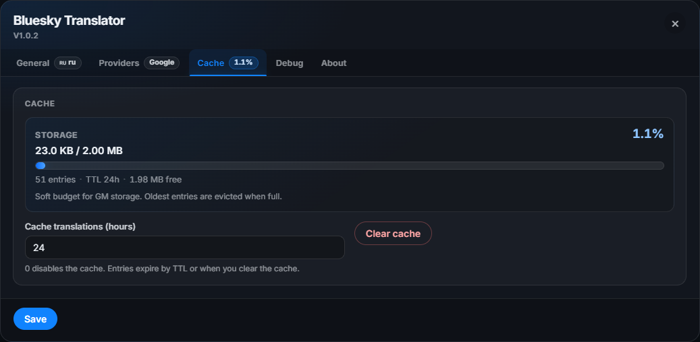

# Bluesky Translator

[English](README.md) · [Русский](README.ru.md) · [中文](README.zh.md) · [Español](README.es.md) · [Português](README.pt.md) · [Deutsch](README.de.md) · [Français](README.fr.md) · **日本語**

[](https://github.com/NemoKing1210/bluesky-translator/actions/workflows/ci.yml)
[](https://raw.githubusercontent.com/NemoKing1210/bluesky-translator/main/bluesky-translator.user.js)
[](LICENSE)
[](CHANGELOG.md)
[](package.json)

[Bluesky](https://bsky.app) の投稿を**その場で翻訳**するユーザースクリプトです。フィードを離れる必要はありません。

[Tampermonkey](https://www.tampermonkey.net/)、[Violentmonkey](https://violentmonkey.github.io/)、[Greasemonkey](https://www.greasespot.net/)、[ScriptCat](https://scriptcat.org/) など、`// ==UserScript==` メタデータブロックに対応したマネージャーと互換性があります。

> **状態：** 安定（`1.0.2`）— 投稿をその場で翻訳、複数のプロバイダー、キャッシュ、フィルター、ライト/ダーク UI。
> **注意：** Bluesky Social PBC とは提携していません。

---

## 目次

- [スクリーンショット](#スクリーンショット)
- [クイックインストール](#クイックインストール)
- [機能](#機能)
- [設定](#設定)
- [仕組み](#仕組み)
- [更新](#更新)
- [FAQ](#faq)
- [セキュリティ](#セキュリティ)
- [作者](#作者)
- [その他のユーザースクリプト](#その他のユーザースクリプト)
- [ライセンス](#ライセンス)

---

## スクリーンショット

実際のユーザースクリプトを Bluesky のライブ投稿と設定ダイアログで表示しています。


| | |
|---|---|
| <br>**プロバイダー** — Google、DeepL、Microsoft、OpenAI、Yandex、LibreTranslate から選択。キーが必要なプロバイダーは専用の項目を表示します | <br>**キャッシュ** — 使用量、TTL、キャッシュ消去 |

---

## クイックインストール

1. ユーザースクリプトマネージャーをインストールします（[Tampermonkey](https://www.tampermonkey.net/)、[Violentmonkey](https://violentmonkey.github.io/)、[ScriptCat](https://scriptcat.org/) 推奨）。
2. 下の GitHub raw URL からインストールします（またはローカルでビルドします）。

**インストール URL（GitHub — 最新版）：**

```
https://raw.githubusercontent.com/NemoKing1210/bluesky-translator/main/bluesky-translator.user.js
```

<p align="center">
  <a href="https://raw.githubusercontent.com/NemoKing1210/bluesky-translator/main/bluesky-translator.user.js"></a>
</p>

### URL からインストール（マネージャーのダッシュボード）

| マネージャー | 手順 |
|--------------|------|
| Tampermonkey | ダッシュボード → **ユーティリティ** → **URL からインストール** |
| Violentmonkey | ダッシュボード → **+** → **URL からインストール** |
| Greasemonkey | アドオンメニュー → **新規ユーザースクリプト** → raw URL を貼り付け |
| ScriptCat | [拡張機能](https://scriptcat.org/) をインストールし、GitHub の raw URL を使用 |

### 手動 / ローカルインストール

```bash
git clone https://github.com/NemoKing1210/bluesky-translator.git
cd bluesky-translator
npm install
npm run build
```

ビルドされた [`bluesky-translator.user.js`](bluesky-translator.user.js) をマネージャーで開きます（または内容を新しいスクリプトにコピーします）。

開発中のホットリロードは `npm run dev` を実行し、Vite が提供するスクリプト（名前の接頭辞 `dev:`）をインストールします。

---

## 機能

### Bluesky（`bsky.app`）での機能

- 投稿テキストの下に独立した行で **Translate** ボタンを表示（読み込み中はスピナー、クリックしても投稿は開きません）
- フィード内の**引用 / 埋め込み**投稿にも同じボタン
- 翻訳は結果パネルに表示（スムーズに展開）、または原文と置き換え（ボタン / ホバープレビュー / 分割表示）。リンクとメンションは引き続きクリック可能
- オプションの**自動**モード：投稿が画面に少しでも表示されたら翻訳（すべてのアカウントまたは許可リスト。設定または投稿メニューから管理）
- アカウントの**ブロックリスト**と入力言語の許可/ブロックリスト（「触らない」フィルター）
- Translate / Hide / Show original / Retry にアイコン
- 対象言語は設定から — **Auto** は UI / ブラウザの言語に従うか、約 40 言語から完全な名前と国旗付きで選択
- 投稿がすでに対象言語の場合はスキップ可能
- Bluesky の SPA ナビゲーションに対応（スクロール、ルート変更、無限フィード）

### 設定と仕上げ

- タブ式の設定パネル：**一般 · プロバイダー · キャッシュ · デバッグ · 概要**
- 翻訳プロバイダー：Google（デフォルト、キー不要）、DeepL、Microsoft、OpenAI、Yandex、LibreTranslate — フィールドは選択したプロバイダーによって変わります
- 入口：
  - 左サイドバーの **Translator** 項目（Bluesky の設定の隣）
  - ユーザースクリプトマネージャーのメニューコマンド
- インターフェース言語：English、Русский、中文、Español、Português、Deutsch、Français、日本語（+ Auto）
- 保存 / キャッシュクリア時のトースト通知
- 翻訳キャッシュをユーザースクリプトのストレージに保存（TTL 設定可能）

### 技術的な詳細

- デフォルトの Google プロバイダーは API キー不要。DeepL / Microsoft / OpenAI / Yandex / LibreTranslate は**設定 → プロバイダー**で認証情報が必要
- リクエストの重複排除 + デバウンス付き DOM 再スキャン
- [Vite](https://vitejs.dev/) + [vite-plugin-monkey](https://github.com/lisonge/vite-plugin-monkey) で構築
- [x-translator](https://github.com/NemoKing1210/x-translator) と [backloggd-plus](https://github.com/NemoKing1210/backloggd-plus) と同じ成果物 / CI ワークフロー

---

## 設定

左ナビゲーションの **Translator**、またはマネージャーメニュー → **Bluesky Translator — Settings** を開きます。

| タブ | 変更できる内容 | デフォルト |
|------|----------------|------------|
| **一般** | インターフェース言語、対象言語バッジ、モード、自動範囲 + 許可リスト、置き換え時の表示、アカウントブロックリスト、入力言語の許可/ブロックリスト、表示モード、対象言語、対象言語ならスキップ | Auto / ボタン / すべて / ボタン / パネル / オン |
| **プロバイダー** | タブの翻訳エンジンバッジ、プロバイダー + API 認証情報 / URL フィールド | Google |
| **キャッシュ** | タブの使用率 % バッジ、使用量メーター、キャッシュ時間（`0` = オフ）、キャッシュをクリア | 24 |
| **デバッグ** | キャッシュヒットのメタ情報、翻訳 / キャッシュヒット統計 | オフ |
| **概要** | 説明、リポジトリリンク、作者カード | — |

保存するとパネルが閉じ、すぐに適用されます（ナビのラベルと投稿ボタンが更新されます）。

---

## 仕組み

1. `document-idle` で `https://bsky.app/*` にマッチします。
2. `POST_TEXT_SELECTORS` で投稿テキストを検索します。`[data-testid="postText"]` を優先し、引用埋め込み（`[aria-label^="Post by"] …`）にも対応 — Bluesky の DOM が変わった場合は `src/constants.js` で調整できます。
3. 対象となる各テキストノードの後に **Translate** ツールバーを挿入します。
4. クリック時にユーザースクリプトサンドボックス（`@connect`）経由で設定されたプロバイダー（デフォルトは Google）にリクエストします。
5. 成功した結果を `GM` ストレージ（`bst_cache_v1`）に保存し、TTL の期限切れまたはキャッシュクリアまで保持します。

Bluesky の Web クライアントは頻繁に更新されます — ボタンが表示されなくなったら、まず `POST_TEXT_SELECTORS` のセレクターを確認してください。

---

## 更新

ビルド済みスクリプトには GitHub の `main` を指す `@updateURL` / `@downloadURL` が含まれています。対応マネージャーは自動的に更新を確認します。

**新しいバージョンをリリースするには：**

1. [`package.json`](package.json) の `version` を上げます（`@version` と `SCRIPT_VERSION` の唯一の情報源）。
2. `npm run build` を実行します（ルートの `bluesky-translator.user.js` / `.meta.js` を再生成）。
3. [`CHANGELOG.md`](CHANGELOG.md) にエントリを追加します。
4. 必要に応じてこの README のバージョンバッジを更新します。
5. `main` にプッシュします。

ローカルセットアップ、コントリビューション、リポジトリ構成については [`DEVELOPMENT.md`](DEVELOPMENT.md)、[`CONTRIBUTING.md`](CONTRIBUTING.md)、[`AGENTS.md`](AGENTS.md) を参照してください。

---

## FAQ

**Google API キーは必要ですか？**  
デフォルトの **Google** プロバイダーでは不要です。DeepL、Microsoft、OpenAI、Yandex、LibreTranslate は**設定 → プロバイダー**で認証情報が必要です。

**Bluesky のパスワードは共有されますか？**  
いいえ。スクリプトはページの DOM から投稿テキストを読むだけで、そのテキストを選択した翻訳プロバイダーに送信します。翻訳のために Bluesky の認証トークンには触れません。入力した API キーはデバイス上のユーザースクリプト GM ストレージに保存されます。

**一部の投稿にボタンが表示されません。**  
空の投稿（メディアのみ）はスキップされます。Bluesky の UI 更新後にテキスト投稿でもボタンが出ない場合は、問題を報告するか `POST_TEXT_SELECTORS` を調整してください。

**キャッシュが大きくなりすぎます。**  
**キャッシュ**の時間を短くする、設定でクリアする、または使用量メーター（約 2 MB のソフト上限、LRU 削除）を確認してください。

**ダークテーマのセレクトが壊れて見えます。**  
最新ビルド（`0.1.2+`）を使用してください — ネイティブの `<select>` オプションは `color-scheme: dark` を使用します。

---

## セキュリティ

脆弱性を見つけましたか？非公開で報告してください — [`SECURITY.md`](SECURITY.md) を参照してください。セキュリティ問題の公開 issue は作成しないでください。

モデルの概要：投稿テキストは選択した翻訳プロバイダーにのみ送信され、API キーとキャッシュされた翻訳はデバイス上のユーザースクリプトストレージに保存されます（暗号化なし）。スクリプトは Bluesky の cookie や認証トークンを読み取りません。カスタムプロバイダーのエンドポイントはユーザーが指定するため、信頼できるホストのみを使用してください。

## 作者

| | |
|---|---|
| **NemoKing** | [@NemoKing1210](https://github.com/NemoKing1210) |
| Email | [nemoking1210@gmail.com](mailto:nemoking1210@gmail.com) |
| リポジトリ | [github.com/NemoKing1210/bluesky-translator](https://github.com/NemoKing1210/bluesky-translator) |

問題とアイデア：[GitHub Issues](https://github.com/NemoKing1210/bluesky-translator/issues)。

---

## その他のユーザースクリプト

同じ作者による他のユーザースクリプト：

| ユーザースクリプト | 機能 |
|--------------------|------|
| [](https://github.com/NemoKing1210/x-translator) | [X](https://x.com)（Twitter）の投稿と返信を**その場で翻訳** — このスクリプトと同じプロバイダー、キャッシュ、フィルターのアプローチ |

---

## ライセンス

[MIT](LICENSE) — Copyright (c) 2026 NemoKing
