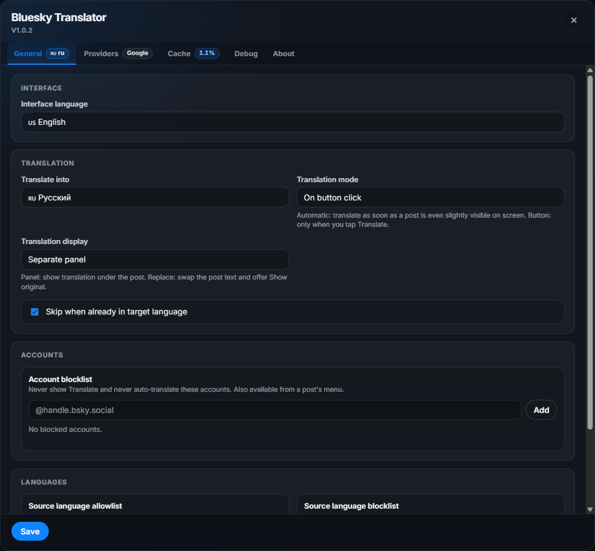

# Bluesky Translator

[English](README.md) · [Русский](README.ru.md) · [中文](README.zh.md) · [Español](README.es.md) · **Português** · [Deutsch](README.de.md) · [Français](README.fr.md) · [日本語](README.ja.md)

[](https://github.com/NemoKing1210/bluesky-translator/actions/workflows/ci.yml)
[](https://raw.githubusercontent.com/NemoKing1210/bluesky-translator/main/bluesky-translator.user.js)
[](LICENSE)
[](CHANGELOG.md)
[](package.json)

Userscript que adiciona **tradução no local** para posts no [Bluesky](https://bsky.app) — sem sair do feed.

Compatível com [Tampermonkey](https://www.tampermonkey.net/), [Violentmonkey](https://violentmonkey.github.io/), [Greasemonkey](https://www.greasespot.net/), [ScriptCat](https://scriptcat.org/) e outros gerenciadores que suportam o bloco de metadados `// ==UserScript==`.

> **Status:** estável (`1.0.2`) — traduz posts no local, vários provedores, cache, filtros, interface clara/escura.
> **Nota:** não é afiliado ao Bluesky Social PBC.

---

## Índice

- [Capturas de tela](#capturas-de-tela)
- [Instalação rápida](#instalação-rápida)
- [Recursos](#recursos)
- [Configurações](#configurações)
- [Como funciona](#como-funciona)
- [Atualizações](#atualizações)
- [Perguntas frequentes](#perguntas-frequentes)
- [Segurança](#segurança)
- [Autor](#autor)
- [Outros userscripts](#outros-userscripts)
- [Licença](#licença)

---

## Capturas de tela

O userscript real em um post ao vivo do Bluesky e na caixa de configurações.




| | |
|---|---|
| <br>**Provedores** — escolha Google, DeepL, Microsoft, OpenAI, Yandex ou LibreTranslate; provedores que exigem chave mostram seus próprios campos | <br>**Cache** — uso, TTL e a ação de limpar cache |

---

## Instalação rápida

1. Instale um gerenciador de userscripts ([Tampermonkey](https://www.tampermonkey.net/), [Violentmonkey](https://violentmonkey.github.io/) ou [ScriptCat](https://scriptcat.org/) recomendados).
2. Instale pela URL direta do GitHub abaixo (ou compile localmente).

**URL de instalação (GitHub — mais recente):**

```
https://raw.githubusercontent.com/NemoKing1210/bluesky-translator/main/bluesky-translator.user.js
```

<p align="center">
  <a href="https://raw.githubusercontent.com/NemoKing1210/bluesky-translator/main/bluesky-translator.user.js"></a>
</p>

### Instalar por URL (painel do gerenciador)

| Gerenciador | Caminho |
|-------------|---------|
| Tampermonkey | Painel → **Utilitários** → **Instalar de URL** |
| Violentmonkey | Painel → **+** → **Instalar de URL** |
| Greasemonkey | Menu da extensão → **Novo script de usuário** → cole a URL direta |
| ScriptCat | Instale a [extensão](https://scriptcat.org/) e use a URL direta do GitHub |

### Instalação manual / local

```bash
git clone https://github.com/NemoKing1210/bluesky-translator.git
cd bluesky-translator
npm install
npm run build
```

Depois abra o arquivo compilado [`bluesky-translator.user.js`](bluesky-translator.user.js) no seu gerenciador (ou copie o conteúdo para um novo script).

Para recarregamento automático durante o desenvolvimento, execute `npm run dev` e instale o script servido pelo Vite (prefixo de nome `dev:`).

---

## Recursos

### No Bluesky (`bsky.app`)

- Botão **Translate** em uma linha própria abaixo do texto do post (indicador de carregamento durante a tradução; o clique não abre o post)
- O mesmo botão em posts **citados / incorporados** no feed
- A tradução aparece em um painel de resultado (expansão suave) ou no lugar do texto original (botão / prévia ao passar o mouse / visão dividida); links e menções continuam clicáveis
- Modo **automático** opcional: traduz assim que o post aparece minimamente na tela (todas as contas ou uma lista permitida; gerenciamento nas configurações ou no menu do post)
- **Lista de bloqueio** de contas e listas de idiomas de origem permitidos/bloqueados (filtros “não mexer”)
- Ícones em Translate / Hide / Show original / Retry
- Idioma de destino nas configurações — **Auto** segue o idioma da interface / navegador, ou escolha entre ~40 idiomas com nomes completos e bandeiras
- Opção de pular quando o post já está no idioma de destino
- Funciona com a navegação SPA do Bluesky (rolagem, mudanças de rota, feed infinito)

### Configurações e acabamento

- Painel de configurações com abas: **Geral · Provedores · Cache · Depuração · Sobre**
- Provedores: Google (padrão, sem chave), DeepL, Microsoft, OpenAI, Yandex, LibreTranslate — os campos dependem do provedor escolhido
- Pontos de entrada:
  - Item **Translator** na barra lateral esquerda (ao lado das configurações do Bluesky)
  - Comando do menu do gerenciador de userscripts
- Idiomas da interface: English, Русский, 中文, Español, Português, Deutsch, Français, 日本語 (+ Auto)
- Avisos para salvar / limpar cache
- Cache de traduções no armazenamento do userscript (TTL configurável)

### Técnico

- O provedor Google padrão não exige chave de API; DeepL / Microsoft / OpenAI / Yandex / LibreTranslate precisam de credenciais em **Configurações → Provedores**
- Deduplicação de solicitações + nova varredura do DOM com debounce
- Criado com [Vite](https://vitejs.dev/) + [vite-plugin-monkey](https://github.com/lisonge/vite-plugin-monkey)
- Mesmo fluxo de artefatos / CI que [x-translator](https://github.com/NemoKing1210/x-translator) e [backloggd-plus](https://github.com/NemoKing1210/backloggd-plus)

---

## Configurações

Abra **Translator** na navegação esquerda, ou o menu do gerenciador → **Bluesky Translator — Settings**.

| Aba | O que você pode alterar | Padrão |
|-----|-------------------------|--------|
| **Geral** | Idioma da interface; selo do idioma de destino; modo; escopo automático + lista permitida; revelação ao substituir; lista de bloqueio de contas; listas de idiomas de origem permitidos/bloqueados; modo de exibição; idioma de destino; pular se já estiver no destino | Auto / botão / todas / botão / painel / ativado |
| **Provedores** | Selo do mecanismo de tradução na aba; provedor + credenciais de API / campos de URL | Google |
| **Cache** | Selo de ocupação % na aba; medidor de uso; horas de cache (`0` = desativado); limpar cache | 24 |
| **Depuração** | Metadados de acertos no cache; estatísticas de tradução / acertos no cache | desativado |
| **Sobre** | Descrição, link do repositório, cartão do autor | — |

Salvar fecha o painel e aplica na hora (os rótulos de navegação e os botões dos posts são atualizados).

---

## Como funciona

1. Corresponde a `https://bsky.app/*` em `document-idle`.
2. Encontra o texto via `[data-testid="postText"]` e posts citados incorporados (`[aria-label^="Post by"] …`) — ajustável em `src/constants.js` se o DOM do Bluesky mudar.
3. Injeta uma barra **Translate** como irmã após cada nó de texto elegível.
4. Ao clicar, solicita o provedor configurado (Google por padrão) pelo sandbox do userscript (`@connect`).
5. Guarda os resultados bem-sucedidos no armazenamento `GM` (`bst_cache_v1`) até o TTL expirar ou você limpar o cache.

O cliente web do Bluesky muda com frequência — se os botões sumirem, verifique primeiro os seletores em `POST_TEXT_SELECTORS`.

---

## Atualizações

O script compilado inclui `@updateURL` / `@downloadURL` apontando para `main` no GitHub. Gerenciadores compatíveis verificam atualizações automaticamente.

**Para lançar uma nova versão:**

1. Aumente `version` em [`package.json`](package.json) (fonte única de `@version` e `SCRIPT_VERSION`).
2. Execute `npm run build` (regenera `bluesky-translator.user.js` / `.meta.js` na raiz).
3. Adicione uma entrada em [`CHANGELOG.md`](CHANGELOG.md).
4. Atualize o selo de versão deste README se necessário.
5. Envie para `main`.

Para configuração local, contribuição e estrutura do repositório, consulte [`DEVELOPMENT.md`](DEVELOPMENT.md), [`CONTRIBUTING.md`](CONTRIBUTING.md) e [`AGENTS.md`](AGENTS.md).

---

## Perguntas frequentes

**Preciso de uma chave de API do Google?**  
Não para o provedor **Google** padrão. DeepL, Microsoft, OpenAI, Yandex e LibreTranslate precisam de credenciais em **Configurações → Provedores**.

**Minha senha do Bluesky é compartilhada?**  
Não. O script apenas lê o texto dos posts do DOM e envia esse texto ao provedor de tradução escolhido. Ele não acessa tokens de autenticação do Bluesky para traduzir. As chaves de API informadas ficam no armazenamento GM do userscript no seu dispositivo.

**Faltam botões em alguns posts?**  
Posts vazios (somente mídia) são ignorados. Se posts com texto também ficarem sem botões após uma atualização do Bluesky, informe o problema ou ajuste `POST_TEXT_SELECTORS`.

**O cache está crescendo demais?**  
Reduza as horas de **Cache**, limpe-o nas configurações ou acompanhe o medidor de uso (limite flexível de ~2 MB com remoção LRU).

**O seletor do tema escuro parece quebrado?**  
Use o build mais recente (`0.1.2+`) — as opções nativas de `<select>` usam `color-scheme: dark`.

---

## Segurança

Encontrou uma vulnerabilidade? Relate em particular — veja [`SECURITY.md`](SECURITY.md). Não abra uma issue pública para problemas de segurança.

Resumo do modelo: o texto do post vai apenas para o provedor de tradução escolhido, as chaves de API e as traduções em cache ficam no armazenamento do userscript no seu dispositivo (sem criptografia), e o script nunca lê cookies ou tokens de autenticação do Bluesky. Endpoints personalizados são fornecidos pelo usuário, então use apenas hosts confiáveis.

## Autor

| | |
|---|---|
| **NemoKing** | [@NemoKing1210](https://github.com/NemoKing1210) |
| Email | [nemoking1210@gmail.com](mailto:nemoking1210@gmail.com) |
| Repositório | [github.com/NemoKing1210/bluesky-translator](https://github.com/NemoKing1210/bluesky-translator) |

Erros e ideias: [GitHub Issues](https://github.com/NemoKing1210/bluesky-translator/issues).

---

## Outros userscripts

Outros userscripts do mesmo autor:

| Userscript | O que faz |
|:-----------|:----------|
| [](https://github.com/NemoKing1210/x-translator) | **Tradução no local** para posts e respostas no [X](https://x.com) (Twitter) — mesma abordagem de provedores, cache e filtros deste script |

---

## Licença

[MIT](LICENSE) — Copyright (c) 2026 NemoKing
