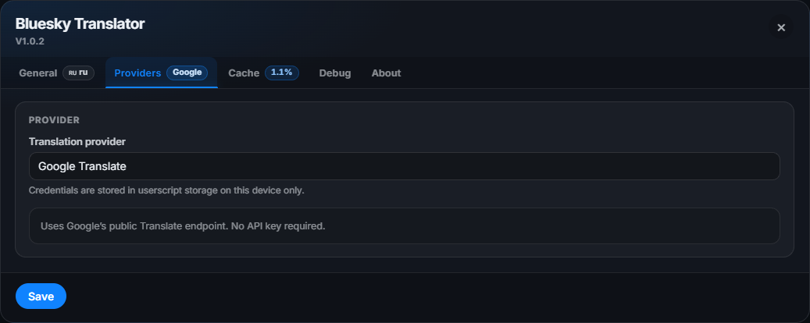

# Bluesky Translator

[English](README.md) · [Русский](README.ru.md) · **中文** · [Español](README.es.md) · [Português](README.pt.md) · [Deutsch](README.de.md) · [Français](README.fr.md) · [日本語](README.ja.md)

[](https://github.com/NemoKing1210/bluesky-translator/actions/workflows/ci.yml)
[](https://raw.githubusercontent.com/NemoKing1210/bluesky-translator/main/bluesky-translator.user.js)
[](LICENSE)
[](CHANGELOG.md)
[](package.json)

用户脚本，为 [Bluesky](https://bsky.app) 的帖子添加**就地翻译**——无需离开信息流。

兼容 [Tampermonkey](https://www.tampermonkey.net/)、[Violentmonkey](https://violentmonkey.github.io/)、[Greasemonkey](https://www.greasespot.net/)、[ScriptCat](https://scriptcat.org/) 以及其他支持 `// ==UserScript==` 元数据块的脚本管理器。

> **状态：** 稳定（`1.0.2`）——就地翻译帖子、多种翻译服务、缓存、过滤器，支持浅色/深色界面。
> **说明：** 与 Bluesky Social PBC 无关。

---

## 目录

- [截图](#截图)
- [快速安装](#快速安装)
- [功能](#功能)
- [设置](#设置)
- [工作原理](#工作原理)
- [更新](#更新)
- [常见问题](#常见问题)
- [安全](#安全)
- [作者](#作者)
- [其他用户脚本](#其他用户脚本)
- [许可证](#许可证)

---

## 截图

真实的用户脚本运行在 Bluesky 实时帖子和设置对话框中。


| | |
|---|---|
| <br>**服务商** — 选择 Google、DeepL、Microsoft、OpenAI、Yandex 或 LibreTranslate；需要密钥的服务商会显示各自的字段 | <br>**缓存** — 用量、TTL 和清除缓存 |

---

## 快速安装

1. 安装用户脚本管理器（推荐 [Tampermonkey](https://www.tampermonkey.net/)、[Violentmonkey](https://violentmonkey.github.io/) 或 [ScriptCat](https://scriptcat.org/)）。
2. 通过下方的 GitHub 原始链接安装（或在本地构建）。

**安装链接（GitHub — 最新版本）：**

```
https://raw.githubusercontent.com/NemoKing1210/bluesky-translator/main/bluesky-translator.user.js
```

<p align="center">
  <a href="https://raw.githubusercontent.com/NemoKing1210/bluesky-translator/main/bluesky-translator.user.js"></a>
</p>

### 通过 URL 安装（管理器面板）

| 管理器 | 路径 |
|--------|------|
| Tampermonkey | 面板 → **实用工具** → **从 URL 安装** |
| Violentmonkey | 面板 → **+** → **从 URL 安装** |
| Greasemonkey | 附加组件菜单 → **新建用户脚本** → 粘贴原始 URL |
| ScriptCat | 安装[扩展](https://scriptcat.org/)，然后使用 GitHub 原始 URL |

### 手动 / 本地安装

```bash
git clone https://github.com/NemoKing1210/bluesky-translator.git
cd bluesky-translator
npm install
npm run build
```

然后在管理器中打开构建好的 [`bluesky-translator.user.js`](bluesky-translator.user.js)（或将其内容复制到新脚本中）。

开发时的热重载：运行 `npm run dev`，安装 Vite 提供的脚本（名称前缀 `dev:`）。

---

## 功能

### 在 Bluesky（`bsky.app`）上

- 在帖子文本下方单独一行显示 **Translate** 按钮（加载时显示旋转图标；点击不会打开帖子）
- 信息流中的**引用/嵌入**帖子也支持同一按钮
- 翻译显示在结果面板中（平滑展开），或替换原文（按钮 / 悬停预览 / 分栏视图）；链接和提及仍可点击
- 可选的**自动**模式：帖子刚出现在屏幕上时立即翻译（所有账户或选定的允许列表；可在设置或帖子菜单中管理）
- 账户**黑名单**和源语言允许/屏蔽列表（“不处理”过滤器）
- Translate / Hide / Show original / Retry 按钮带图标
- 目标语言在设置中选择——**Auto** 跟随界面/浏览器语言，或从约 40 种语言中选择（带完整名称和旗帜）
- 可选：帖子已经是目标语言时跳过
- 兼容 Bluesky 的 SPA 导航（滚动、路由切换、无限信息流）

### 设置与细节

- 带标签页的设置面板：**常规 · 翻译服务 · 缓存 · 调试 · 关于**
- 翻译服务：Google（默认，无需密钥）、DeepL、Microsoft、OpenAI、Yandex、LibreTranslate——字段取决于所选服务
- 入口：
  - 左侧边栏的 **Translator** 项（Bluesky 设置旁边）
  - 用户脚本管理器菜单命令
- 界面语言：English、Русский、中文、Español、Português、Deutsch、Français、日本語（+ Auto）
- 保存 / 清除缓存时显示 toast 通知
- 翻译缓存保存在用户脚本存储中（可配置 TTL）

### 技术细节

- 默认 Google 服务无需 API 密钥；DeepL / Microsoft / OpenAI / Yandex / LibreTranslate 需要在**设置 → 翻译服务**中填写凭据
- 请求去重 + 防抖的 DOM 重新扫描
- 使用 [Vite](https://vitejs.dev/) + [vite-plugin-monkey](https://github.com/lisonge/vite-plugin-monkey) 构建
- 与 [x-translator](https://github.com/NemoKing1210/x-translator) 和 [backloggd-plus](https://github.com/NemoKing1210/backloggd-plus) 相同的产物 / CI 流程

---

## 设置

在左侧导航中打开 **Translator**，或使用管理器菜单 → **Bluesky Translator — Settings**。

| 标签页 | 可以更改 | 默认 |
|--------|----------|------|
| **常规** | 界面语言；目标语言徽章；模式；自动范围 + 允许列表；替换时显示原文；账户黑名单；源语言允许/屏蔽列表；显示模式；目标语言；已是目标语言时跳过 | Auto / 按钮 / 全部 / 按钮 / 面板 / 开 |
| **翻译服务** | 标签页上的翻译引擎徽章；翻译服务 + API 凭据 / URL 字段 | Google |
| **缓存** | 标签页上的占用率 % 徽章；使用量指示器；缓存小时数（`0` = 关闭）；清除缓存 | 24 |
| **调试** | 缓存命中元信息；翻译 / 缓存命中统计 | 关 |
| **关于** | 描述、仓库链接、作者卡片 | — |

保存会关闭面板并立即生效（导航标签和帖子按钮会刷新）。

---

## 工作原理

1. 在 `document-idle` 时匹配 `https://bsky.app/*`。
2. 通过 `POST_TEXT_SELECTORS` 查找帖子文本：优先 `[data-testid="postText"]`，也支持引用嵌入（`[aria-label^="Post by"] …`）——如果 Bluesky 的 DOM 变化，可在 `src/constants.js` 中调整。
3. 在每个符合条件的文本节点后插入 **Translate** 工具栏。
4. 点击时通过用户脚本沙箱（`@connect`）请求配置的翻译服务（默认 Google）。
5. 将成功结果保存到 `GM` 存储（`bst_cache_v1`），直到 TTL 过期或清除缓存。

Bluesky 网页客户端更新频繁——如果按钮不再出现，请先检查 `POST_TEXT_SELECTORS` 中的选择器。

---

## 更新

构建的脚本带有指向 GitHub `main` 的 `@updateURL` / `@downloadURL`。受支持的管理器会自动检查更新。

**发布新版本：**

1. 提升 [`package.json`](package.json) 中的 `version`（`@version` 和 `SCRIPT_VERSION` 的唯一来源）。
2. 运行 `npm run build`（重新生成根目录的 `bluesky-translator.user.js` / `.meta.js`）。
3. 在 [`CHANGELOG.md`](CHANGELOG.md) 中添加条目。
4. 如有需要，更新此 README 中的版本徽章。
5. 推送到 `main`。

本地设置、贡献指南和仓库结构请参阅 [`DEVELOPMENT.md`](DEVELOPMENT.md)、[`CONTRIBUTING.md`](CONTRIBUTING.md) 和 [`AGENTS.md`](AGENTS.md)。

---

## 常见问题

**需要 Google API 密钥吗？**  
默认的 **Google** 服务不需要。DeepL、Microsoft、OpenAI、Yandex 和 LibreTranslate 需要在**设置 → 翻译服务**中填写凭据。

**我的 Bluesky 密码会被共享吗？**  
不会。脚本只从页面 DOM 读取帖子文本，并将该文本发送给所选的翻译服务。翻译时不会触碰 Bluesky 的认证令牌。你输入的 API 密钥存储在设备的用户脚本 GM 存储中。

**某些帖子没有按钮？**  
空帖子（仅媒体）会被跳过。如果 Bluesky 界面更新后文本帖子也没有按钮，请报告问题或调整 `POST_TEXT_SELECTORS`。

**缓存越来越大？**  
降低**缓存**小时数、在设置中清除缓存，或查看使用量指示器（约 2 MB 软上限，带 LRU 淘汰）。

**深色主题下下拉框看起来有问题？**  
使用最新构建（`0.1.2+`）——原生 `<select>` 选项使用 `color-scheme: dark`。

---

## 安全

发现漏洞？请私下报告——见 [`SECURITY.md`](SECURITY.md)。不要为安全问题创建公开 issue。

模型简述：帖子文本只会发送给所选的翻译服务，API 密钥和缓存的翻译保存在你设备的用户脚本存储中（未加密），脚本从不读取 Bluesky 的 cookie 或认证令牌。自定义服务端点由你自行提供，因此请只使用可信主机。

## 作者

| | |
|---|---|
| **NemoKing** | [@NemoKing1210](https://github.com/NemoKing1210) |
| 邮箱 | [nemoking1210@gmail.com](mailto:nemoking1210@gmail.com) |
| 仓库 | [github.com/NemoKing1210/bluesky-translator](https://github.com/NemoKing1210/bluesky-translator) |

问题与建议：[GitHub Issues](https://github.com/NemoKing1210/bluesky-translator/issues)。

---

## 其他用户脚本

同一作者的其他用户脚本：

| 用户脚本 | 功能 |
|:---------|:-----|
| [](https://github.com/NemoKing1210/x-translator) | 为 [X](https://x.com)（Twitter）的帖子和回复提供**就地翻译**——与本脚本相同的服务、缓存和过滤方案 |

---

## 许可证

[MIT](LICENSE) — Copyright (c) 2026 NemoKing
